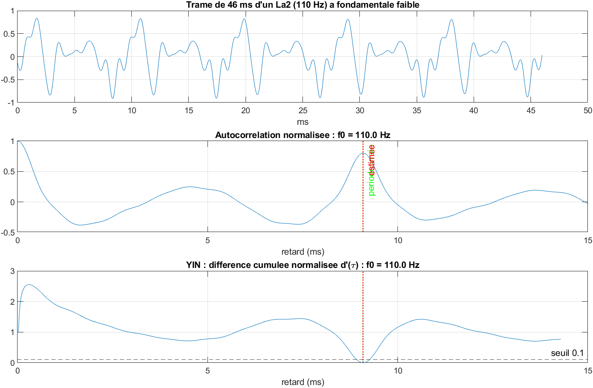

# Accordeur : fréquence fondamentale par autocorrélation et YIN

Estimer la hauteur d'une note jouée ou chantée et indiquer l'écart, en cents, à la note juste la plus proche. Deux estimateurs classiques sont comparés : l'**autocorrélation** et l'algorithme **YIN**. Le projet inclut un accordeur en temps réel au micro.



## 1. Ce qu'on cherche : la période d'un signal

Un son de hauteur stable (une corde, une voix qui tient une note) est **périodique**. On peut l'écrire comme une somme d'harmoniques :

```math
x(t) = \sum_{k=1}^{K} a_k \sin(2\pi k f_0 t + \varphi_k)
```

- $`f_0`$ est la **fréquence fondamentale** : c'est elle qui fixe la hauteur perçue.
- Les harmoniques $`2f_0, 3f_0, \dots`$ fixent le **timbre**.
- Le signal se répète toutes les $`T_0 = 1/f_0`$ secondes : $`x(t + T_0) = x(t)`$.

**La période reste $`T_0`$ même si la fondamentale est absente** ($`a_1 = 0`$). Les fréquences $`2f_0, 3f_0, \dots`$ sont toutes des multiples de $`f_0`$, et leur somme se répète encore toutes les $`T_0`$. C'est pour cela que l'oreille entend la bonne note sur un téléphone, qui coupe les graves. Un estimateur fondé sur la **périodicité**, et non sur le pic le plus fort du spectre, retrouve donc la bonne note dans ce cas.

**En numérique**, le signal est échantillonné à $`f_s`$ (par exemple 44 100 Hz). La période s'exprime alors en nombre d'échantillons :

```math
\tau_0 = \frac{f_s}{f_0}
```

Pour un La3 à 220 Hz, $`\tau_0 \approx 200{,}5`$ échantillons. **Estimer $`f_0`$ revient à estimer $`\tau_0`$.**

On analyse le signal par **trames** de $`N`$ échantillons (46 ms). Une trame doit contenir au moins deux périodes de la note la plus grave, ce qui fixe la borne basse $`f_{min}`$. Les bornes $`[f_{min}, f_{max}]`$ limitent la recherche à $`\tau \in [f_s/f_{max},\ f_s/f_{min}]`$.

## 2. Première méthode : l'autocorrélation

**Définition.** On compare la trame à elle-même, décalée de $`\tau`$ échantillons :

```math
r(\tau) = \sum_{n=0}^{N-1-\tau} x[n]\, x[n+\tau]
```

**Pourquoi le maximum donne la période.** Si le signal est périodique de période $`\tau_0`$, alors $`x[n + \tau_0] = x[n]`$, donc $`r(\tau_0) = \sum x[n]^2`$. C'est le maximum possible : par l'inégalité de Cauchy-Schwarz, $`|r(\tau)| \le r(0)`$.

On normalise par $`\rho(\tau) = r(\tau)/r(0) \in [-1, 1]`$. Cette valeur mesure la ressemblance, et vaut 1 pour une répétition parfaite. On cherche donc :

```math
\hat\tau = \arg\max_{\tau \in [f_s/f_{max},\, f_s/f_{min}]} \rho(\tau)
```

**Calcul rapide par la FFT** (théorème de Wiener-Khintchine). L'autocorrélation est la transformée de Fourier inverse de la densité spectrale :

```math
r = \mathcal{F}^{-1}\big(|X|^2\big)
```

Le calcul passe ainsi de $`O(N^2)`$ à $`O(N \log N)`$. La FFT suppose cependant le signal **périodique sur la trame** : elle calcule une corrélation circulaire, où la fin de la trame se « replie » sur le début. On complète donc la trame par des zéros jusqu'à $`2N`$ (zero-padding) : le décalage ne peut plus ramener d'échantillons du début, et on obtient l'autocorrélation linéaire exacte.

**Limite : l'erreur d'octave.**
- **Biais de longueur** : $`r(\tau)`$ ne somme que $`N - \tau`$ termes, donc elle décroît mécaniquement avec $`\tau`$. Les petits décalages sont favorisés.
- **Fondamentale faible** : quand l'harmonique 2 domine, le signal ressemble presque à un signal de période $`\tau_0/2`$, et $`\rho(\tau_0/2)`$ devient élevé.

Dans les deux cas, la méthode peut choisir $`\tau_0/2`$ et annoncer une note **une octave trop haute**.

## 3. Seconde méthode : YIN (de Cheveigné & Kawahara, 2002)

**Étape 1 : la fonction de différence.** Au lieu de mesurer la ressemblance, on mesure l'écart :

```math
d(\tau) = \sum_{j} \big(x_j - x_{j+\tau}\big)^2
```

Pour un signal exactement périodique, $`d(\tau_0) = 0`$ : on cherche un **zéro**, et non un maximum. En développant le carré, on retrouve le lien avec l'autocorrélation :

```math
d(\tau) = \underbrace{\sum x_j^2}_{\text{énergie de la trame}} + \underbrace{\sum x_{j+\tau}^2}_{\text{énergie de la trame décalée}} - 2\, r(\tau)
```

Les deux énergies sont calculées sur les échantillons effectivement comparés. Elles **compensent** donc la décroissance de $`r(\tau)`$ avec $`\tau`$, ce qui corrige le biais de longueur de l'autocorrélation.

**Étape 2 : la différence cumulée normalisée.** $`d(\tau)`$ a deux défauts :
- $`d(0) = 0`$ toujours (minimum trivial) ;
- sa valeur dépend du volume : multiplier le signal par $`a`$ multiplie $`d`$ par $`a^2`$, et un seuil fixe n'a donc pas de sens.

YIN divise $`d(\tau)`$ par sa moyenne sur les décalages plus petits :

```math
d'(0) = 1, \qquad d'(\tau) = \frac{d(\tau)}{\dfrac{1}{\tau}\displaystyle\sum_{j=1}^{\tau} d(j)}
```

- **Le minimum trivial disparaît** : $`d'`$ part de 1.
- **Le résultat ne dépend plus du volume** : le facteur $`a^2`$ se simplifie entre le numérateur et le dénominateur.
- **Interprétation** : $`d'(\tau)`$ compare l'écart au décalage $`\tau`$ à l'écart moyen pour les décalages plus courts. Une valeur proche de 0 signifie « au décalage $`\tau`$, le signal se répète beaucoup mieux qu'en moyenne ».

**Étape 3 : le seuil absolu et le premier creux.** Si $`\tau_0`$ est la période, alors $`2\tau_0, 3\tau_0, \dots`$ en sont aussi : $`d'`$ présente des creux presque aussi profonds à chaque multiple. Prendre le minimum global risquerait de choisir $`2\tau_0`$, soit une note **une octave trop basse**. YIN prend donc le **premier** $`\tau`$ tel que :

```math
d'(\tau) < \theta \qquad (\theta = 0{,}1)
```

puis descend jusqu'au fond de ce creux. Le vrai creux est toujours le premier, car les multiples viennent après lui.

**La profondeur du creux est une mesure de qualité.** La valeur $`d'(\hat\tau)`$ estime la part **apériodique** du signal :
- proche de 0 : son très périodique ;
- proche de 1 : bruit, consonne, souffle.

Si aucun creux ne passe sous le seuil, on prend le premier creux voisin du minimum global, et non le minimum global lui-même, qui tombe souvent sur un multiple de la période.

**Comportement face au bruit.** On ajoute un bruit blanc de variance $`\sigma^2`$, indépendant du signal. En moyenne, pour $`\tau \ge 1`$ :

```math
\mathbb{E}[d(\tau)] = d_{signal}(\tau) + 2(N-\tau)\,\sigma^2
```

Le bruit **remonte uniformément le fond des creux** : le creux de la période ne descend plus jusqu'à 0, et peut rester au-dessus du seuil.

Pour l'autocorrélation, le bruit blanc n'est corrélé avec lui-même qu'au décalage nul :

```math
\mathbb{E}[r(\tau)] = r_{signal}(\tau) + N\sigma^2\,\delta(\tau)
```

Seul $`r(0)`$ est modifié. Le pic à $`\tau_0`$ est abaissé après normalisation, mais **il ne bouge pas**. Cela explique pourquoi l'autocorrélation résiste mieux au bruit blanc.

## 4. Gagner en précision : l'interpolation parabolique

$`\hat\tau`$ est un nombre entier d'échantillons, alors que la vraie période ne l'est presque jamais (par exemple 200,5). Une erreur sur $`\tau`$ donne une erreur relative sur la fréquence :

```math
\frac{\Delta f}{f} = \frac{\Delta\tau}{\tau}, \qquad \Delta_{cents} \approx \frac{1200}{\ln 2}\cdot\frac{\Delta\tau}{\tau}
```

Pour un La4 ($`\tau \approx 100`$), une erreur de 0,5 échantillon vaut environ **8,7 cents**, ce qui est audible.

On ajuste donc une parabole sur les trois valeurs autour de l'extremum, $`y_{-1}`$, $`y_0`$ et $`y_{+1}`$ (prises en $`\hat\tau - 1`$, $`\hat\tau`$ et $`\hat\tau + 1`$). Son sommet se trouve en :

```math
\delta = \frac{y_{-1} - y_{+1}}{2\,(y_{-1} - 2y_0 + y_{+1})}, \qquad \hat\tau_{fin} = \hat\tau + \delta, \quad \delta \in \left[-\tfrac12, \tfrac12\right]
```

Autour d'un extremum lisse, la courbe est bien approchée par son développement de Taylor d'ordre 2, c'est-à-dire par une parabole. L'erreur résiduelle devient une petite fraction d'échantillon. La fréquence finale vaut :

```math
\hat f_0 = \frac{f_s}{\hat\tau_{fin}}
```

## 5. De la fréquence à la note

**La gamme tempérée.** Une octave correspond à un rapport de fréquences de 2. Elle est divisée en 12 demi-tons égaux **en rapport**, et non en différence. Deux notes voisines sont donc séparées d'un facteur $`2^{1/12} \approx 1{,}0595`$.

En prenant le La4 = 440 Hz comme référence (numéro MIDI 69), la note de numéro $`n`$ a pour fréquence :

```math
f_n = 440 \cdot 2^{(n-69)/12}
```

**Inversion.** Pour une fréquence mesurée $`f`$ :

```math
n = 69 + 12\log_2\!\left(\frac{f}{440}\right)
```

- l'entier le plus proche $`\mathrm{round}(n)`$ donne la note visée ;
- $`\mathrm{round}(n) \bmod 12`$ donne son nom (Do, Do#, Ré, …) ;
- $`\lfloor \mathrm{round}(n)/12 \rfloor - 1`$ donne son octave.

**L'écart en cents.** Le cent divise le demi-ton en 100 parties égales en rapport : 1 cent $`= 2^{1/1200} \approx 1{,}000578`$. L'écart à la note juste $`f_{ref}`$ vaut :

```math
c = 1200 \log_2\!\left(\frac{f}{f_{ref}}\right) \in [-50, +50]
```

**Pourquoi le logarithme.** L'oreille perçoit les **rapports** de fréquences, pas les différences. Un écart de 5 Hz vaut :
- environ 70 cents sur un Mi2 (82 Hz), c'est-à-dire presque un demi-ton ;
- environ 13 cents sur un Mi5 (659 Hz).

Le cent, lui, a la même signification à toutes les hauteurs. Par exemple, 445 Hz au lieu de 440 Hz donne $`c = 1200\log_2(445/440) \approx +19{,}6`$ cents.

## 6. Le suivi dans le temps

Pour une mélodie ou pour l'accordeur en direct, le signal est découpé en trames successives qui se chevauchent : longueur $`N`$, avancée de $`h`$ échantillons (10 ms). On obtient une courbe $`f_0(t)`$.

Une trame dont l'énergie $`\sum x[n]^2`$ est trop faible est déclarée **silencieuse**, et aucune hauteur n'est estimée. La période n'y a pas de sens, et l'estimateur ne produirait que du bruit.

## Accordeur temps réel

```matlab
>> realtime_tuner(60, 'yin')
```

L'accordeur écoute le micro (`audiorecorder`, MATLAB de base) par trames de 2048 échantillons à 22 050 Hz. Il affiche une aiguille de −50 à +50 cents, verte quand la note est juste à ±5 cents près.

## Lancer le projet

```matlab
>> cd chemin/vers/accordeur-yin-autocorrelation
>> main
```

- MATLAB R2021a ou plus récent, aucune toolbox requise.
- Placez vos enregistrements (voix chantée, guitare...) en `.wav` mono dans `data/` pour obtenir leur courbe de f₀ et leur note médiane.
